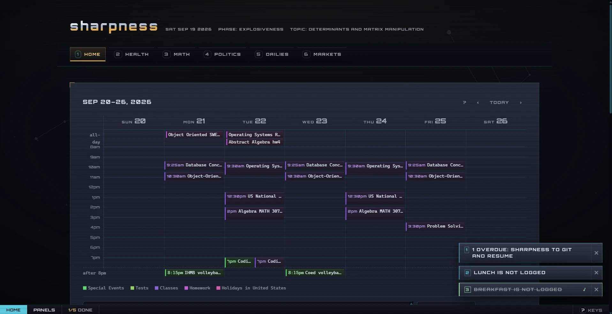
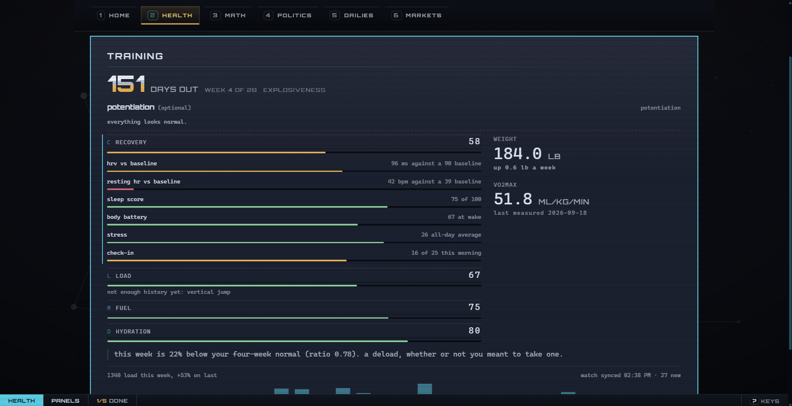
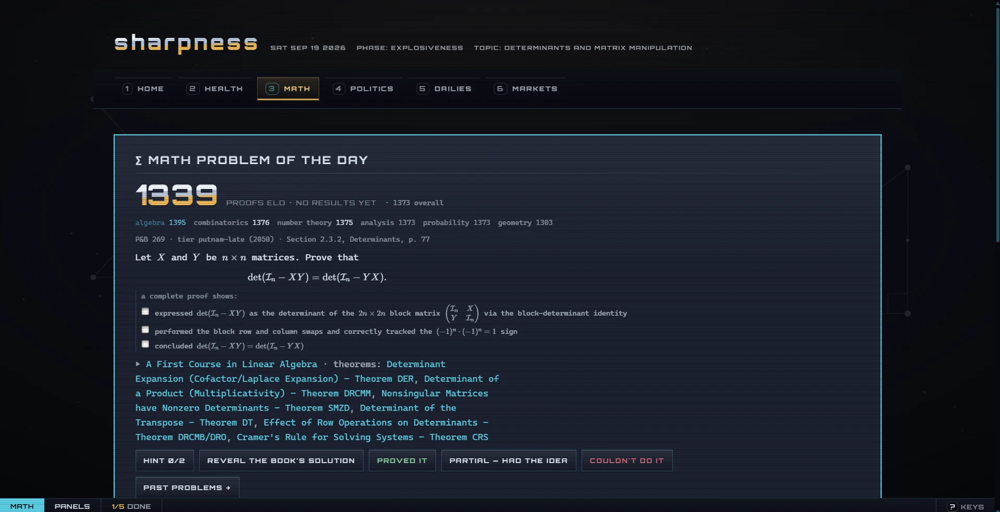

# Sharpness

A personal dashboard that runs on my laptop and holds the parts of my day I
want to *do*, not just read: my calendar and coursework, a rated
competition-math practice track, a training block with recovery data from my
watch, and a set of small daily exercises. A companion phone app logs meals,
training sessions and check-ins when I'm away from the desk.



## Why I built it

My day was spread across a calendar, Garmin Connect, a training spreadsheet,
a stack of problem books and a handful of daily puzzle sites. None of them knew
about the others, and none of them could tell me whether the day's work was
actually done. I wanted one page that knows what the day asks of me, keeps
score honestly, and stays out of the way when there is nothing to say.

A few rules shaped every feature:

- **One person, one machine.** The server binds to `127.0.0.1`, keeps its data
  in a single SQLite file and has no accounts. That isn't a placeholder for a
  multi-user version; the simplicity is the point.
- **Keyboard first.** Every tab, panel and log is reachable without the mouse,
  and the mouse still works. Vim keybinds are life.
- **Numbers have to earn their place.** A derived figure shows nothing until
  there is enough history for it to mean something, and the panel says *which*
  input is missing rather than drawing a zero.
- **Cheap to run.** Expensive generation, such as the week's math problems,
  happens in an overnight batch on a Claude subscription. The live API calls
  are a few small requests, each logged with its cost, so the daily spend is
  recorded.

## What's in it

The dashboard is six tabs, each with one main panel that says what the tab is
for and smaller panels beneath it. NOTE: Politics tab is set for removal.

### Home: calendar and coursework

The week grid is drawn from Google Calendar through
[gcalcli](https://github.com/insanum/gcalcli). Under it is a quick-add box
that takes plain lines of text, one item per line, and works out the title,
day, time and recurrence locally. I made this wrapper since the gcalcli commands
were too janky/boilerplate in my experience. A small scikit-learn classifier, trained on
the account's own event history, suggests which calendar each item belongs
on. Items in the "homework" and "test" calendars become a due list, and
ticking one off deletes its event, but only when exactly one event matches. A
year heatmap shows which days were completed.

Reminders in the corner cover things still outstanding: an unlogged meal,
the morning check-in, an overdue assignment. Each one has a cooldown so it
never becomes something I learn to dismiss.

### Health: training and recovery



A training block is written in `training.toml` as a library of session types
plus a week-by-week schedule. The tab shows today's prescribed session, how
far into the block I am, and four scores:

- **Recovery:** HRV and resting heart rate against baseline, sleep, Body
  Battery, stress and a morning check-in.
- **Load:** session RPE × minutes, compared week against week.
- **Fuel:** meals, compared with the measured weight trend.
- **Hydration:** drinks and output.

Each score is a plain average of whichever inputs actually reported, and each
can be opened to see its parts. Watch data comes from an optional Garmin
Connect sync that never overwrites a value I entered by hand.

*Why:* the watch measures a lot but answers none of the questions I had about
a training block: am I recovering, am I training hard enough, and which way is
my weight going. Load is RPE-based rather than heart-rate-based because wrist
heart rate is the least trustworthy number a watch produces during
combat-sports training.

### Math: a rated practice track



One problem a day, rated with Elo, with a separate rating for each area
(algebra, combinatorics, number theory and so on). The topic rotates weekly,
weighted by how often each area appears on the Putnam. The week has a fixed
shape:

- **Monday and Tuesday:** a problem pitched at my current rating.
- **Wednesday to Saturday:** proofs from *Putnam and Beyond*, graded against a
  rubric written from the book's own solution. Thursday and Friday share a
  single harder problem, and its hints unlock only after a day without one.
- **Sunday:** reading, not rated.

Alongside the problem are a "trick of the day" (one technique with a set of
problems that use it) and a theorem-recall deck that I build by adding
theorems as I meet them.

*Why:* I'm preparing for the Putnam, and without a rating it is easy to
drift toward problems that feel productive but are too easy. Proofs are rated
in their own bucket so that honest proof scores don't drag down the ratings
that set the difficulty of the computational days.

### Politics: a weekly issue

Each week covers one current policy issue. The panel assembles a reading list
and a prompt; I argue the issue in the Claude app and paste back a graded
write-up, which is filed by subject and rated. A deck of named argument
patterns (principal–agent problems, base-rate neglect and so on) is drilled
like the theorem deck.

*Why:* to practise forming and defending a position, not just reading about
one. The argument happens on a subscription, so the loop costs nothing per
day.

### Dailies

Small things that are worth doing but none of which deserves a tab of its
own: a word of the day to use in sentences, a spelling drill from a curated
word list, a lichess puzzle with a self-reported result, Wordle and Pokedoku
results parsed from their share text, a piano scale or chord played from
recorded samples, and one arXiv paper ranked against a plain-text list of my
interests.

### Markets

A watchlist of quotes, plus an optional portfolio panel. The portfolio reads a
brokerage export kept on disk (never committed), and it stays locked behind
Windows Hello through WebAuthn until it is unlocked for a few minutes.

### Phone log (`/m`)

An installable web app for the logging that happens away from the desk:
the morning check-in, meals, drinks, bathroom visits, training sessions and a
twice-daily "how do you feel" prompt. Every entry is saved on the phone first
and sent when I press *send*, so a gym with no signal loses nothing. It
reaches the laptop over [Tailscale](https://tailscale.com/), never over the
public internet. The phone and the laptop share one definition of every log,
so the two cannot drift apart.

### What counts as a finished day

The day has two layers. Five items are **required**: the day's math (problem,
trick and theorem recall), the morning check-in, and three logged meals.
Those drive the streak. Everything else is **optional** and earns points.
I'd rather have a floor I can hold every day than a ceiling I reach twice a
month.

## Running it

Sharpness runs on Linux, macOS, or Windows through WSL. It needs Python 3.11
or newer.

```bash
./run.sh
```

On first run this creates a virtualenv, installs dependencies and opens
`http://localhost:8502`. On Windows, `run.cmd` does the same from Explorer.

Optional pieces:

- **Google Calendar:** install and authenticate `gcalcli` in the same
  environment the server runs in.
- **Anthropic API:** put `ANTHROPIC_API_KEY=...` in `.env` for the few live
  calls: picking the word of the day, grading its sentences and theorem
  recall, and checking the level of a problem you bring yourself.
- **Garmin:** `pip install -e '.[garmin]'`, then
  `python -m dashboard.garmin login` once. The server works from the saved
  tokens and never holds your password.
- **Phone app:** see [docs/operations.md](docs/operations.md#the-phone-log--m)
  for the Tailscale setup.

Everything configurable lives in `config.toml`: the topic rotation, rating
anchors, tickers, feeds, calendars, todo aliases and the port. A typo there
fails at startup with the name of the field. This is built around one
person's routine, so expect to edit that file before it fits yours.

Personal data stays out of the repository. The database, logs, API keys,
brokerage exports and textbook PDFs are all gitignored.

### Tests

```bash
python -m pytest && npm test
```

Neither suite touches the network, the API or your database. The JavaScript
tests use Node's built-in runner, so there is nothing to `npm install`.

## How it's built

- **Server:** FastAPI and Pydantic over SQLite, with versioned migrations.
  Every write has its own endpoint, and ratings are derived from an
  append-only event log, so two open tabs can't overwrite each other.
- **Front end:** plain ES modules with no build step and no runtime npm
  dependencies. KaTeX, xterm.js, the heading font and the piano samples are
  vendored with their licences, so the page works offline.
- **Dates:** the browser decides what day it is, and every dated request
  carries that date. The server never consults its own clock for it.
- **Feeds:** responses are cached and served stale when a source goes down,
  and the panel says how old they are.

```
dashboard/     the server: routes, scoring, health maths, feeds, the Garmin sync
  db/          schema, migrations and the repository
web/           the dashboard front end
  app/panels/  one module per panel
  m/           the phone app and its service worker
tests/         pytest, plus tests/js for node --test
watch/         an early Connect IQ experiment for the watch
```

[docs/operations.md](docs/operations.md) is the detailed reference: keyboard
bindings, the phone setup, and the reasoning behind individual mechanics.

## Licence

MIT. See [LICENSE](LICENSE).
